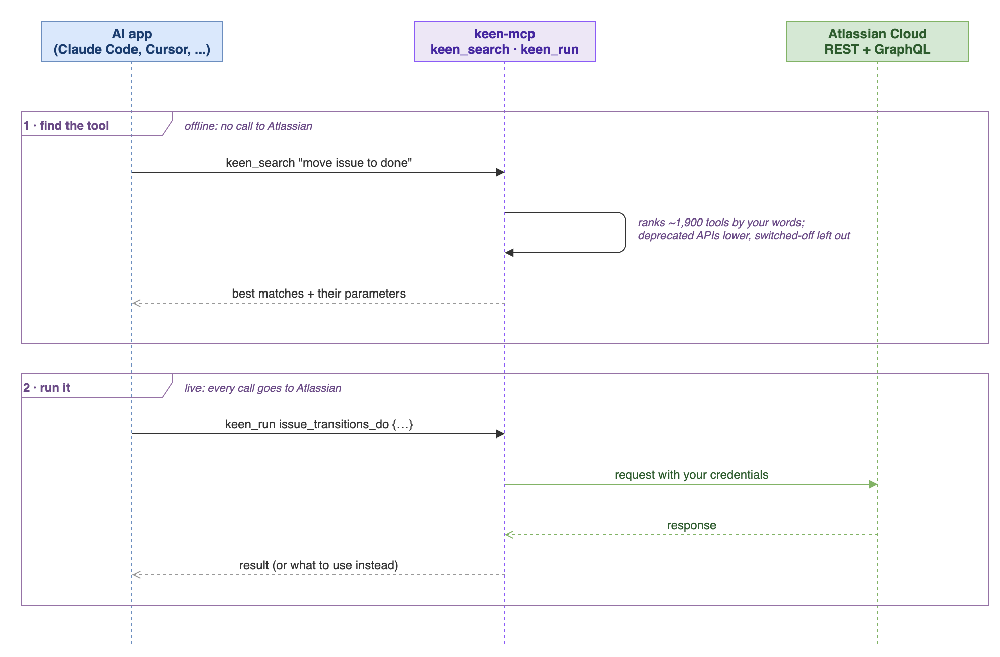
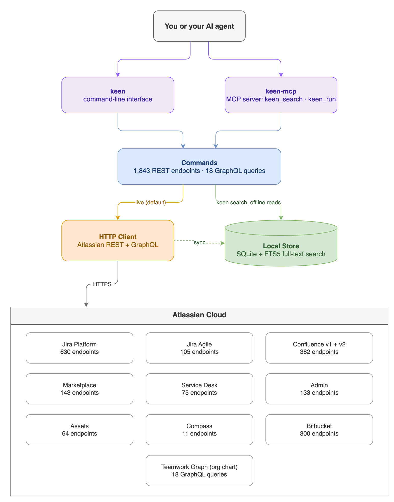

# Keen

<p align="center"><strong>The complete Atlassian platform CLI.</strong></p>

<p align="center">
    <a href="https://github.com/imogenlabs/keen/releases/latest">
        
    </a>
    <a href="https://github.com/imogenlabs/keen/blob/main/LICENSE">
        
    </a>
    <a href="https://go.dev">
        
    </a>
    <a href="https://github.com/imogenlabs/keen/actions/workflows/ci.yml">
        
    </a>
    <a href="https://goreportcard.com/report/github.com/imogenlabs/keen">
        
    </a>
</p>

<p align="center">
    <a href="https://imogenlabs.ai">
        
    </a>
</p>

---

1,843 API endpoints across Jira, Confluence, Agile, Marketplace, Service Desk, Assets, Compass, Bitbucket and Admin — in a single Go binary. SQLite-backed local sync with full-text search. MCP server for AI agents. Built for automation first, humans second.

## What is Keen?

Every Atlassian workflow you automate is a wall of `curl` calls with hand-rolled JSON payloads and fragile `jq` parsing. Every AI agent that touches Jira hits rate limits after a few dozen operations.

Keen replaces all of that with typed commands, structured output, local SQLite caching with FTS5 full-text search, and an MCP server that gives AI agents fast, uncapped access to your entire Atlassian stack.

**Free and open source.** Apache-2.0 license. No account required. No telemetry.

## API Coverage

| API | Endpoints | What you get |
|-----|-----------|-------------|
| **Jira Platform v3** | 630 | Issues, transitions, search, bulk ops, fields, workflows, permissions |
| **Jira Agile** | 105 | Sprints, boards, backlogs, epics, ranking, velocity |
| **Confluence** | 130 | CQL search, spaces, labels, templates, attachments, permissions, content states |
| **Confluence v2** | 252 | Pages, blog posts, spaces, folders, databases, whiteboards, comments, attachments, space roles |
| **Marketplace v2** | 143 | Addons, versions, vendors, distribution, reviews, reporting |
| **Service Desk** | 75 | Requests, queues, customers, SLAs, approvals |
| **Assets** | 64 | Objects, object schemas and types, AQL search, imports (`keen assets-...`). keen finds your cloud and workspace ids from the site |
| **Compass** | 11 | Events, metric values, attachments and API specs for components |
| **Teamwork Graph** | 18 queries | Org chart (manager, direct reports, report chain), teams, a person's created, commented, mentioned and viewed work, over GraphQL ([Teamwork Graph](docs/Teamwork-Graph.md)). Plus `keen graphql` for any read query |
| **Bitbucket** | 300 | Repositories, pull requests, pipelines, branches, commits, snippets, workspaces (`keen bitbucket-...`). Public data works without a token; private data needs a Bitbucket-scoped token ([Authentication](docs/Authentication.md)) |
| **Admin** | 133 | Organizations, directories, groups, domains, policies, user management, user provisioning (SCIM), API tokens and service accounts, data loss prevention. Needs an admin API key ([Authentication](docs/Authentication.md)) |

## Your First 5 Minutes

```bash
# 1. Install (macOS Apple Silicon; see Install for Linux)
curl -L https://github.com/imogenlabs/keen/releases/latest/download/keen_darwin_arm64.tar.gz | tar xz
sudo mv keen_darwin_arm64/keen keen_darwin_arm64/keen-mcp /usr/local/bin/

# 2. Save your credentials
mkdir -p ~/.config/keen
cat > ~/.config/keen/auth.json <<'JSON'
{ "base_url": "https://yoursite.atlassian.net", "username": "you@example.com", "password": "your-api-token" }
JSON
chmod 600 ~/.config/keen/auth.json

# 3. Check connectivity
keen doctor

# 4. Sync your Jira data locally
keen sync

# 5. Search instantly (no API calls)
keen search "authentication bug" --data-source local
```

Generate an API token at [id.atlassian.com/manage-profile/security/api-tokens](https://id.atlassian.com/manage-profile/security/api-tokens).

Environment variables work too, and override the file:

```bash
export JIRA_CLOUD_PLATFORM_USERNAME="you@example.com"
export JIRA_CLOUD_PLATFORM_PASSWORD="your-api-token"
export JIRA_CLOUD_PLATFORM_URL="https://yoursite.atlassian.net"
```

## Install

### Binary download

Download from [GitHub Releases](https://github.com/imogenlabs/keen/releases/latest):

```bash
# macOS (Apple Silicon)
curl -L https://github.com/imogenlabs/keen/releases/latest/download/keen_darwin_arm64.tar.gz | tar xz
sudo mv keen_darwin_arm64/keen /usr/local/bin/
sudo mv keen_darwin_arm64/keen-mcp /usr/local/bin/

# Linux (x86_64)
curl -L https://github.com/imogenlabs/keen/releases/latest/download/keen_linux_amd64.tar.gz | tar xz
sudo mv keen_linux_amd64/keen /usr/local/bin/
sudo mv keen_linux_amd64/keen-mcp /usr/local/bin/

# Linux (arm64)
curl -L https://github.com/imogenlabs/keen/releases/latest/download/keen_linux_arm64.tar.gz | tar xz
sudo mv keen_linux_arm64/keen /usr/local/bin/
sudo mv keen_linux_arm64/keen-mcp /usr/local/bin/
```

Each release also publishes `checksums.txt`.

### From source

```bash
git clone https://github.com/imogenlabs/keen.git
cd keen
make build-all   # builds bin/keen and bin/keen-mcp
```

Requires Go 1.26.10 or newer.

What changed in each release: [CHANGELOG.md](CHANGELOG.md).

## MCP Server

Keen includes an MCP server (`keen-mcp`) that gives AI agents every keen command (1,939 tools). Works with Claude Code, Cursor, Windsurf, and any MCP-compatible host.

It offers two tools: `keen_search` finds the tools for a task ("transition an issue", "list sprints on a board") and returns them with their parameters, and `keen_run` runs one by name. Listing all 1,939 tools one by one would take about half a million tokens, more than most models can hold, so an app connecting to keen would fill up before doing any work. To get the full list anyway, set `KEEN_MCP_TOOLS=all` in the server's environment.

Tool calls arrive as JSON-RPC over stdio. Finding a tool happens inside keen-mcp with no call to Atlassian; running one always goes to Atlassian live, so the answer is never stale. If a tool's API has been switched off by Atlassian, the result says what to use instead.

<p align="center">
  
</p>

Source: [`docs/diagrams/mcp-flow.drawio`](docs/diagrams/mcp-flow.drawio).

`keen-mcp` finds credentials the same way the CLI does: environment variables first, then `~/.config/keen/auth.json` or `config.toml`. If you already set up the CLI, `claude mcp add --transport stdio keen -- keen-mcp` is enough. To pass them explicitly instead:

### Claude Code

```bash
claude mcp add --transport stdio keen \
  --env JIRA_CLOUD_PLATFORM_USERNAME=you@example.com \
  --env JIRA_CLOUD_PLATFORM_PASSWORD=your-api-token \
  --env JIRA_CLOUD_PLATFORM_URL=https://yoursite.atlassian.net \
  -- keen-mcp
```

### Cursor

Add to `.cursor/mcp.json`:

```json
{
  "mcpServers": {
    "keen": {
      "command": "keen-mcp",
      "env": {
        "JIRA_CLOUD_PLATFORM_USERNAME": "you@example.com",
        "JIRA_CLOUD_PLATFORM_PASSWORD": "your-api-token",
        "JIRA_CLOUD_PLATFORM_URL": "https://yoursite.atlassian.net"
      }
    }
  }
}
```

### Windsurf

Add to `~/.codeium/windsurf/mcp_config.json` with the same structure.

## Local Sync & Offline Search

Keen syncs your Atlassian data to a local SQLite database with FTS5 full-text search. Queries run in under 100ms against the local cache instead of hitting the Jira Cloud API.

```bash
keen sync                                          # hydrate local cache
keen search "sprint bug" --data-source local        # FTS search (sub-100ms)
keen analytics                                      # analytics on synced data
keen stale --days 30                                # find stale items
keen orphans                                        # find orphaned items
keen load                                           # workload distribution
```

This is especially useful for AI agents that need to make many queries without hitting [Atlassian's rate limits](https://developer.atlassian.com/cloud/jira/platform/rate-limiting/).

## Agent Mode

Every command supports `--agent` which sets JSON output, no interactive prompts, compact format, and no color in one flag. Designed for AI agent consumption.

```bash
keen agile get-all-boards --agent
keen issue transitions get PROJ-42 --agent | jq '.results.transitions[] | {id, name}'
```

The everyday Jira calls have short forms:

```bash
keen find-issues --jql "project = PROJ AND status = 'In Progress'" --agent
keen get PROJ-42 --agent
keen transition PROJ-42 --transition-name "In Progress" --agent   # name resolved to its id
keen sprints 42 --state active --agent
```

## Key Flags

| Flag | What it does |
|------|-------------|
| `--agent` | JSON + no prompts + compact (use this for all scripted calls) |
| `--compact` | Only key fields (id, name, status, timestamps) |
| `--json` | Force JSON output |
| `--csv` | CSV output |
| `--dry-run` | Show what would be sent without sending |
| `--stdin` | Read request body as JSON from stdin |
| `--select "key,fields.summary"` | Keep only these fields (dotted paths reach nested ones). A mistyped field fails with a suggestion |
| `--output-summary[=N]` | If the output is over N bytes (default 4096), save it to a private temp file and print a one-line JSON summary with the file path, size and record count |
| `--quiet` | One value per line |
| `--data-source local` | Query local SQLite cache only |

## Command Discovery

```bash
keen which "sprint"          # find commands by keyword
keen which "create page"     # natural language search
keen api                     # browse all API interfaces
keen api wiki                # browse Confluence endpoints
keen api agile               # browse Agile endpoints
```

## Common Workflows

### Sprint Management

```bash
keen agile get-all-boards --agent
keen agile get-all-sprints BOARD_ID --state active,future --agent
keen agile create-sprint --stdin <<< '{"name":"Sprint 5","originBoardId":42}'
keen agile move-issues-to-sprint-and-rank SPRINT_ID \
  --stdin <<< '{"issues": ["PROJ-42", "PROJ-43"]}'
keen agile partially-update-sprint SPRINT_ID --stdin <<< '{"state": "active"}'
```

### Release Tracking

Record git release tags as Jira versions and tag the issues they shipped:

```bash
# every release tag so far, plus an unreleased "next" for work merged since
keen release sync --repo-path . --project PROJ --backfill --head origin/main --dry-run
# after publishing a release: "next" becomes the tag, a fresh "next" is created
keen release sync --repo-path . --project PROJ --tag v1.4.0 --head origin/main
```

A version is named as the tag, released on the tag's commit date and linked to
its GitHub release. An issue gets the first release whose commits name its key
as a Fix Version; existing Fix Versions are added to, never replaced.

### Issue Lifecycle

```bash
keen jira-cloud-platform-search and-reconsile-issues-using-jql-post \
  --jql "project = PROJ AND status != Done" --agent
keen issue transitions get PROJ-42 --agent
keen issue transitions do PROJ-42 --transition-id 41 --agent
keen issue comment add PROJ-42 --body "Done."    # plain text is wrapped into ADF
```

### Confluence

```bash
keen wiki search-content-by-cql --cql "type=page AND space=DOCS" --agent
keen wiki create-page --space DOCS --title "Release notes" --stdin < notes.xhtml
keen wiki update-page PAGE_ID --stdin < notes.xhtml   # version bumped for you
keen wiki get-page PAGE_ID --agent
keen wiki get-content-descendants PAGE_ID --agent
keen wiki add-labels-to-content PAGE_ID --stdin <<< '[{"prefix":"global","name":"adr"}]'
```

Page bodies are Confluence storage format (XHTML); Markdown is not converted.

### Marketplace

```bash
keen addons get io.example.my-addon --agent
keen addons list-search --q "story points" --agent
keen addons versions get io.example.my-addon --agent
```

## Comparison

| Feature | Keen | Atlassian Rovo MCP | jira-cli | ACLI (Appfire) |
|---------|------|--------------------|----------|----------------|
| Endpoints | 1,843 | 46+ | Jira only | Many |
| Local cache | SQLite + FTS5 | No | No | No |
| MCP server | Yes | Yes (official) | No | No |
| Products | 9 (Jira, Confluence, Agile, Marketplace, Service Desk, Admin, Assets, Compass, Bitbucket) | 5 | 1 | 4 |
| Price | Free (Apache-2.0) | Free with Cloud | Free (MIT) | $360-$6,195/yr |
| Binary | Single Go binary | Remote server | Single Go binary | Requires JVM |
| Offline search | Yes | No | No | No |

## Architecture

The `keen` CLI and the `keen-mcp` server share one set of commands over 1,843 REST endpoints and 18 GraphQL queries. Calls go to Atlassian live by default. `keen sync` copies data into a local SQLite + FTS5 store, which `keen search` and offline reads (`--data-source local`, or automatically when Atlassian cannot be reached) use.

<p align="center">
  
</p>

Source: [`docs/diagrams/architecture.drawio`](docs/diagrams/architecture.drawio) (editable in [draw.io](https://app.diagrams.net/)).

## Regeneration

keen is generated from 15 official Atlassian OpenAPI specs (in `specs/`) by [CLI Printing Press](https://github.com/mvanhorn/cli-printing-press), then carries its own changes on top. The list of specs lives in one place, `SPECS` in `scripts/regen/config.sh`. One script refreshes keen from Atlassian's current specs without losing those changes:

```bash
git switch -c build/refresh-specs
scripts/regen/regen.sh        # download current specs, generate, merge onto keen
scripts/regen/check.sh        # build, tests, lint, vulnerabilities, old-name and help checks
```

How it works: the generator's previous output (renamed to keen) is kept on GitHub as the hidden ref `refs/regen/base` (not a branch; `regen.sh` fetches it). `regen.sh` generates again from today's specs, renames that output the same way, and does a three-way git merge onto keen. Spec changes land, and keen's own edits stay. Files keen writes by hand (README, docs, changelog, the patch list) always keep keen's version. `scripts/regen/postfix.py` applies keen's standing rules to code the generator adds for the first time. `scripts/regen/placeholders.py` gives help examples a placeholder that fits each argument (the generator puts `your-token-here` in every `*Key` argument), and `check.sh` fails if one slips back.

If the merge stops on a conflict, the script lists the files. Resolve them in the work folder it prints (`scripts/regen/resolve.py ours|theirs <file>` takes one side for a whole file), then run `scripts/regen/finish.sh`. When the branch is merged to `main`, move the base forward as `regen.sh` says.

To see what Atlassian has changed since the last refresh, without changing anything, run `scripts/regen/specdiff.py`. It lists the operations added, removed or changed in each spec. A weekly GitHub workflow (`.github/workflows/spec-check.yml`) runs the same check, opens one issue when anything differs and closes it once keen is current again, so a change is never missed.

`scripts/mcp-check.py <dir with keen and keen-mcp>` tests the MCP server against a live site the way an AI app uses it: it asks `keen_search` for ten everyday tasks in plain words, runs the tool through `keen_run` and compares the answer with the CLI's. It fails when the right tool is not in the top three, or when a tool ranked above it is one Atlassian has switched off. With `--claude` it also hands Claude Code keen-mcp as its only tools and checks it answers real questions with no failed call. It picks its test data from the site, and `check.sh` runs it alongside the live smoke test.

To add an Atlassian API, add one `name=URL` line to the end of `SPECS` and run the two commands above. Nothing else needs editing.

The org chart and Teamwork Graph commands come from Atlassian's GraphQL schema instead of an OpenAPI spec. `scripts/regen/graphql.py` reads it (no login needed), keeps a snapshot in `specs/graphql.json` and writes the command table; the refresh runs it, and the weekly check compares the live schema with the snapshot.

If Atlassian retires an API, the generator stops producing its command. Add it to `internal/compat/compat.go` so the old command and MCP tool keep their name and tell people what replaced it. Every local change is listed in `.printing-press-patches.json`.

Atlassian also keeps deprecated APIs in its specs, sometimes after switching them off. `scripts/regen/deprecated.py` lists every operation the specs mark deprecated (the refresh runs it, and `check.sh` fails if the list is out of date); keen labels those commands and tools, and `keen_search` ranks them below the alternatives. When one starts answering 410 Gone, add it to `RemovedEndpoints` in `internal/compat/deprecated.go` with what to use instead: keen then hides it, its command and tool name the replacement, and `keen sync` skips it.

## Security

See [SECURITY.md](SECURITY.md) for vulnerability reporting. Keen reads API credentials from environment variables or from `~/.config/keen/auth.json`. If you use the file, keep it readable only by you (`chmod 600`). The local SQLite database contains cached API responses and should be treated as sensitive.

## Contributing

See [CONTRIBUTING.md](CONTRIBUTING.md). Bug fixes welcome. Open an issue before submitting PRs for new features.

## License

Apache-2.0

---

<p align="center">Built by <a href="https://imogenlabs.ai">Imogen Labs</a></p>
